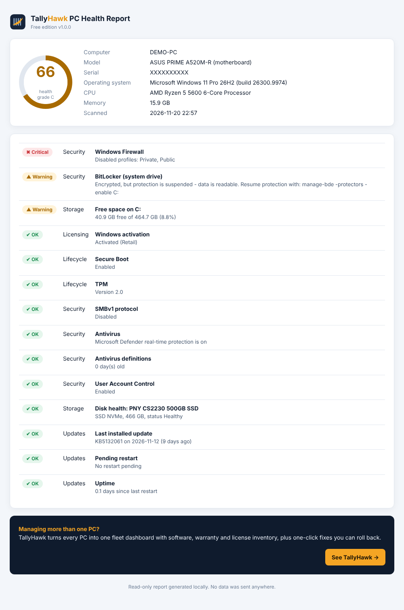

<p align="center"></p>

# TallyHawk PC Health Report

**A free, one-file PowerShell script that gives any Windows PC a 0-100 health score and a clean HTML report in under a minute.**
Read-only. No install. No agent. No data leaves the machine.



## What it checks

| Area | Checks |
|---|---|
| Storage | Free space per drive, physical disk health (SMART status via Storage module) |
| Security | Antivirus real-time protection (Defender or third-party), definition age, Windows Firewall profiles, BitLocker, SMBv1, UAC |
| Updates | Last installed update, pending restart, uptime |
| Licensing | Windows activation status and channel |
| Lifecycle | Windows 10 end of support, TPM version, Secure Boot |

Scoring: start at 100, **-20** per critical, **-7** per warning, **-1** per info item. Grades A-F.

## Quick start

```powershell
# 1. Download Get-PCHealthReport.ps1
# 2. Right-click PowerShell > Run as administrator (recommended, for BitLocker/TPM/Secure Boot)
powershell -ExecutionPolicy Bypass -File .\Get-PCHealthReport.ps1
```

The report opens in your browser and is saved to your Desktop as `PC-Health_<COMPUTER>_<date>.html`.

Options:

```powershell
.\Get-PCHealthReport.ps1 -OutputPath C:\Reports -NoOpen
```

## Requirements

- Windows 10 / 11 or Windows Server 2016+
- Windows PowerShell 5.1 or PowerShell 7+

## FAQ

**Does it change anything?** No. Every call is a read (CIM/WMI, registry, Storage and Defender cmdlets).

**Why "unknown" for BitLocker?** Those checks need an elevated PowerShell window.

**Can I run it on 50 PCs and compare them?** This script is single-PC by design. For fleets, see below.

## Need the whole fleet?

**[TallyHawk - IT Inventory & Health Kit](https://dilgec.gumroad.com/l/tallyhawk)** is the full version:

- One HTML dashboard for every PC (search, sort, filter, CSV export)
- Hardware, software, monitor, license and **warranty** inventory
- Security posture matrix across the fleet and Windows 11 readiness
- **One-click fixes with snapshot + rollback** (temp cleanup, Defender, firewall, SMBv1, Windows Update repair, print spooler...)
- Weekly scheduled scans, GPO/RMM friendly silent collector
- One-time price, no subscription, no cloud

## Also free

**[TallyHawk Software & License Auditor](https://github.com/harundilgec76-dot/tallyhawk-license-auditor)**: every installed app, Windows/Office activation and end-of-life software for one PC.

## License

MIT - free for personal and commercial use.
